# Reembolsos Integrado: solicitudes de reembolso de gastos corporativos

[](https://github.com/NicolasSnchz/sanchez-post1-u12-patrones/actions/workflows/arquitectura.yml)

Post-contenido de la unidad 12 de Patrones de Diseño de Software (UDES). Nicolás Andrés Sánchez Villamizar.

Sistema para que el área de Finanzas reemplace su hoja de cálculo de reembolsos. Los empleados registran una solicitud con la categoría del gasto, el monto, la fecha y sus documentos soporte, y el sistema la valida, calcula el monto aprobado y avisa a los interesados cada vez que cambia de estado. Todo lo que este README afirma sobre el comportamiento del sistema sale de ejecuciones reales en GitHub Actions: los registros están en [`docs/evidencias`](docs/evidencias) y las capturas, en [`docs/capturas`](docs/capturas).
| | Resultado |
|---|---|
| Patrones | Chain of Responsibility (RF1), Strategy (RF2) y Observer (RF3), propuestos antes de programar |
| Arquitectura | Capas simples, con la decisión registrada en el [ADR-001](docs/adr/ADR-001.md) |
| Pruebas | 68 en verde: unitarias de cada validador, calculadora y notificador, del servicio, de integración por HTTP y las 4 reglas de ArchUnit |
| Pipeline | Falló con la violación intencional de la Regla 1 y volvió a verde con el revert ([captura](#el-pipeline-detecta-la-violación)) |

## Contenido

1. [Diseño Propuesto](#diseño-propuesto)
2. [Arquitectura resultante](#arquitectura-resultante)
3. [Decisiones de diseño](#decisiones-de-diseño)
4. [ADR-001: capas simples o Hexagonal](#adr-001-capas-simples-o-hexagonal)
5. [Qué se descartó y por qué](#qué-se-descartó-y-por-qué)
6. [Evidencia](#evidencia)
7. [Checkpoints de la guía y dónde se cumplen](#checkpoints-de-la-guía-y-dónde-se-cumplen)
8. [Inconsistencias del enunciado y cómo las resolví](#inconsistencias-del-enunciado-y-cómo-las-resolví)
9. [Estructura, ejecución y herramientas](#estructura-ejecución-y-herramientas)
10. [Conclusiones](#conclusiones)

## Diseño Propuesto

Esta sección la escribí antes de implementar cualquier patrón: está en el primer commit del repositorio, junto con el modelo de dominio y sin una sola clase de `procesamiento`. Para cada requisito busqué primero qué es lo que cambia y después qué patrón aísla justo eso.

| Requisito | Punto de variabilidad concreto | Patrón | Por qué ese patrón y no otro |
|---|---|---|---|
| **RF1.** Validación en varias etapas | El conjunto de verificaciones: hoy son tres (documentos, tope de la categoría y duplicados), y Finanzas ya anunció una cuarta (límite anual acumulado). La primera que falla decide el motivo del rechazo. | **Chain of Responsibility** | Cada verificación decide sola si rechaza o deja pasar la solicitud al siguiente eslabón, así que la verificación nueva se agrega como un eslabón más sin abrir las que ya existen. |
| **RF2.** Cálculo distinto por categoría | La fórmula del monto aprobado: tope diario por días de viaje, monto completo hasta un tope mensual, o 80 % hasta un tope anual. Se elige una sola vez, por la categoría. | **Strategy** | Son algoritmos intercambiables que responden la misma pregunta (cuánto se aprueba) y se eligen por un dato de entrada, así que cada categoría nueva es una clase nueva y las fórmulas existentes no se tocan. |
| **RF3.** Notificación simultánea | Quiénes reaccionan a un cambio de estado y cómo: el empleado siempre, Contabilidad solo con aprobaciones y auditoría siempre, para su registro. Y el número de interesados crece (ya viene el panel de métricas). | **Observer** | El servicio solo anuncia que el estado cambió y cada interesado decide qué hacer, así que el panel de métricas entra como un observador más sin tocar el servicio ni los otros tres. |

**Alternativas que consideré para cada requisito**

- **RF1.** Una `List<Validador>` recorrida con un `for` también funcionaría, y lo reconozco: la diferencia con la cadena es pequeña. Elijo la cadena porque el requisito describe *etapas* en orden, donde la primera que falla detiene el proceso, y porque así cada eslabón es una clase con una sola razón para cambiar. Descarto Decorator: ninguna verificación envuelve ni modifica el resultado de otra.
- **RF2.** Descarto Template Method, porque las tres fórmulas no comparten un esqueleto: lo único común es aplicar un tope al final. También descarto un `enum` con un método por constante, que fue lo que elegí en la unidad 11 para un conjunto de tipos *cerrado y estable*. Aquí el requisito dice lo contrario: vienen categorías nuevas cada semestre, y cada calculadora como bean propio se puede probar y agregar sola.
- **RF3.** Llamar a los tres notificadores directamente desde el servicio obligaría a editar el servicio con cada interesado nuevo, que es justo lo que el requisito quiere evitar.

**Cómo se componen.** Los tres patrones son independientes entre sí: viven en `procesamiento/validacion`, `procesamiento/calculo` y `procesamiento/notificacion`, y solo `SolicitudReembolsoService` los coordina. Ninguno conoce a los otros dos ni a la base de datos. El servicio carga los datos y se los entrega ya listos.

## Arquitectura resultante

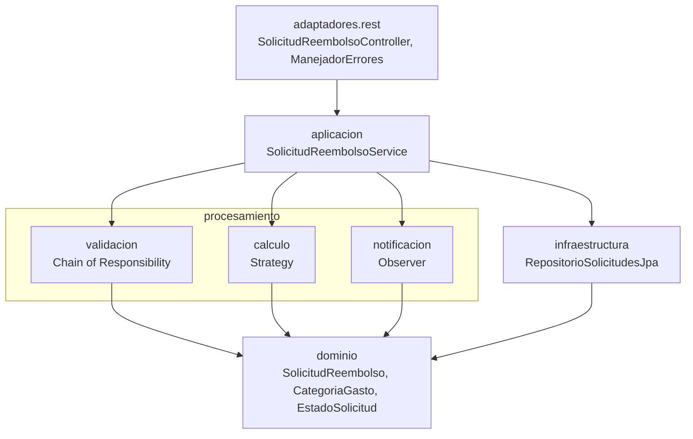

Las flechas son dependencias de código y todas bajan:

- **El controlador** solo conoce el servicio.
- **El servicio** es el único punto que coordina los tres patrones y el único que conoce el repositorio ([`crear`](https://github.com/NicolasSnchz/sanchez-post1-u12-patrones/blob/main/src/main/java/com/empresa/reembolsos/aplicacion/SolicitudReembolsoService.java#L28) y [`cambiarEstado`](https://github.com/NicolasSnchz/sanchez-post1-u12-patrones/blob/main/src/main/java/com/empresa/reembolsos/aplicacion/SolicitudReembolsoService.java#L40)).
- **`procesamiento`** no sabe que existe una base de datos ni una API REST. Recibe la solicitud y la lista de pendientes ya cargadas.
- **`dominio`** no importa nada de Spring ni de JPA. La tabla se mapea en [`orm.xml`](https://github.com/NicolasSnchz/sanchez-post1-u12-patrones/blob/main/src/main/resources/META-INF/orm.xml), y la razón está en las [inconsistencias](#inconsistencias-del-enunciado-y-cómo-las-resolví).

| Patrón | Dónde está | Qué resuelve |
|---|---|---|
| Chain of Responsibility | [`ValidadorSolicitud`](https://github.com/NicolasSnchz/sanchez-post1-u12-patrones/blob/main/src/main/java/com/empresa/reembolsos/procesamiento/validacion/ValidadorSolicitud.java) y sus tres eslabones, armados en [`CadenaValidadores`](https://github.com/NicolasSnchz/sanchez-post1-u12-patrones/blob/main/src/main/java/com/empresa/reembolsos/procesamiento/validacion/CadenaValidadores.java) | RF1: una verificación nueva (el límite anual) es un eslabón más |
| Strategy | [`CalculadoraReembolso`](https://github.com/NicolasSnchz/sanchez-post1-u12-patrones/blob/main/src/main/java/com/empresa/reembolsos/procesamiento/calculo/CalculadoraReembolso.java), tres calculadoras y [`SelectorCalculadora`](https://github.com/NicolasSnchz/sanchez-post1-u12-patrones/blob/main/src/main/java/com/empresa/reembolsos/procesamiento/calculo/SelectorCalculadora.java) | RF2: una categoría nueva (bienestar) es una calculadora más |
| Observer | [`ObservadorCambioEstado`](https://github.com/NicolasSnchz/sanchez-post1-u12-patrones/blob/main/src/main/java/com/empresa/reembolsos/procesamiento/notificacion/ObservadorCambioEstado.java) y tres notificadores | RF3: un interesado nuevo (el panel de métricas) es un observador más |

## Decisiones de diseño

### Decisión de diseño 1: el orden de la cadena

**Orden elegido: documentos, luego monto y por último duplicados**, de la verificación más barata a la más cara ([`CadenaValidadores`](https://github.com/NicolasSnchz/sanchez-post1-u12-patrones/blob/main/src/main/java/com/empresa/reembolsos/procesamiento/validacion/CadenaValidadores.java#L16)).

| Eslabón | Qué revisa | Costo |
|---|---|---|
| `ValidadorDocumentosSoporte` | Un `boolean` de la solicitud | Constante |
| `ValidadorMontoMaximo` | Busca el tope de la categoría en un mapa y compara | Constante |
| `ValidadorDuplicados` | Recorre la lista de pendientes del empleado comparando categoría y período | Crece con el número de pendientes |

**Qué se gana poniendo el más caro al final:** una solicitud sin documentos o con un monto excesivo se rechaza sin recorrer la lista de pendientes. Esos son además los errores más probables de quien llena el formulario.

**Qué se pierde:**

- **El empleado solo ve el primer motivo.** Si le faltan los documentos *y* además ya tiene una solicitud pendiente del mismo período, primero corrige los documentos, vuelve a enviar y solo entonces se entera del duplicado. Con duplicados de primero, sabría de entrada que reenviar no sirve de nada mientras siga la pendiente.
- **El ahorro es menor de lo que parece.** La operación realmente cara es la consulta a la base de datos que trae los pendientes, y esa la hace el servicio [antes de llamar a la cadena](https://github.com/NicolasSnchz/sanchez-post1-u12-patrones/blob/main/src/main/java/com/empresa/reembolsos/aplicacion/SolicitudReembolsoService.java#L29), sea cual sea el orden. El orden solo ahorra el recorrido en memoria.

Hacer perezosa esa consulta lo dejé como alternativa descartada ([ver abajo](#qué-se-descartó-y-por-qué)). El orden queda fijado por las pruebas de [`CadenaValidadoresTest`](https://github.com/NicolasSnchz/sanchez-post1-u12-patrones/blob/main/src/test/java/com/empresa/reembolsos/procesamiento/validacion/CadenaValidadoresTest.java): con una solicitud que falla en las tres etapas, el motivo debe ser el de documentos.

### Decisión de diseño 2: un mapa de estrategias inyectado por Spring, no un switch

[`SelectorCalculadora`](https://github.com/NicolasSnchz/sanchez-post1-u12-patrones/blob/main/src/main/java/com/empresa/reembolsos/procesamiento/calculo/SelectorCalculadora.java) recibe la `List<CalculadoraReembolso>` con todas las calculadoras que Spring encuentra y la convierte en un mapa por categoría. El RF2 es explícito: Finanzas va a agregar categorías nuevas *sin modificar el cálculo de las existentes*. Esto es lo que cuesta agregar "bienestar" con cada opción:

| Cambio para agregar BIENESTAR | Con el mapa inyectado | Con un switch |
|---|---|---|
| Escribir la fórmula | Clase nueva `CalculadoraBienestar` con `@Component` | Un `case` nuevo |
| Archivo que hay que editar para la fórmula | Ninguno: el selector la recibe solo | El método que contiene las fórmulas de las otras tres categorías |
| Valor nuevo en `CategoriaGasto` | Sí (es la lista de categorías del dominio) | Sí |
| Tope nuevo en `ValidadorMontoMaximo` | Sí, una línea (el RF1 pide un tope por categoría) | Sí |

Solo el mapa cumple el RF2 tal como está escrito: ninguna línea de las calculadoras existentes ni del selector se toca. Siendo honesto, "sin tocar una sola línea ya escrita" no es literal en ninguna de las dos opciones: la categoría nueva tiene que existir en el `enum` y tener su tope. Esos dos olvidos no pasan en silencio. [`obtener_todaCategoriaTieneSuCalculadora`](https://github.com/NicolasSnchz/sanchez-post1-u12-patrones/blob/main/src/test/java/com/empresa/reembolsos/procesamiento/calculo/SelectorCalculadoraTest.java#L19) y [`validar_todaCategoriaTieneUnTopeConfigurado`](https://github.com/NicolasSnchz/sanchez-post1-u12-patrones/blob/main/src/test/java/com/empresa/reembolsos/procesamiento/validacion/ValidadorMontoMaximoTest.java#L51) recorren todos los valores del `enum` y fallan si a alguno le falta su calculadora o su tope. Y si dos calculadoras dijeran atender la misma categoría, `Collectors.toMap` lanzaría una excepción al arrancar, en vez de elegir una al azar.

### Decisión de diseño 3: capas simples para la persistencia (ADR-001)

Está documentada completa en el [ADR-001](#adr-001-capas-simples-o-hexagonal).

### Decisión de diseño 4: la Regla 1 prohíbe acceso a datos y web, no todo Spring

La [Regla 1](https://github.com/NicolasSnchz/sanchez-post1-u12-patrones/blob/main/src/test/java/com/empresa/reembolsos/ReglasArquitectura.java#L19) prohíbe que `procesamiento` dependa de `infraestructura`, `adaptadores`, `org.springframework.data..` y `jakarta.persistence..`, pero deja pasar `@Component`. La distinción es a propósito:

- **`@Component` es solo metadato de ensamblaje.** Le dice a Spring "crea uno de estos", pero no le da a la clase ningún comportamiento ni la ata a una tecnología. Si mañana se quitara Spring, habría que borrar una anotación por clase y la lógica quedaría intacta. La prueba de eso es que todas las pruebas unitarias de `procesamiento` crean sus objetos con `new`, sin levantar ningún contexto.
- **Una clase de Spring Data o de JPA sí ata la regla de negocio a la persistencia.** Con un repositorio o un `EntityManager` adentro, el validador ya no se puede probar sin una base de datos, y la frontera que el [ADR-001](docs/adr/ADR-001.md) deja en el servicio desaparece. Es exactamente la violación que se simula en el Paso 5.
- **Las clases de la capa web** (`ResponseEntity`, `HttpStatus`) meterían el protocolo de transporte dentro de las reglas de negocio.

Prohibir todo `org.springframework..` obligaría a quitar `@Component` de las once clases de `procesamiento` y a registrarlas a mano en una clase `@Configuration`. Sería más código y una cosa más que mantener sincronizada, sin ganar ninguna independencia real (KISS). Lo comprobé ejecutando esa regla estricta en GitHub Actions: falla por las anotaciones `@Component` y por nada más ([registro](docs/evidencias/logs/experimento-regla-estricta.log)).
## ADR-001: capas simples o Hexagonal

Resumen del [ADR-001](docs/adr/ADR-001.md), fechado el 12 de noviembre de 2026. Respondí el criterio de la guía (Hexagonal vale la pena en sistemas que viven tres años o más *con cambios de infraestructura*) por separado para cada dependencia:

| | Persistencia | Notificación |
|---|---|---|
| Lo que hay hoy | Un repositorio, una consulta derivada y dos operaciones heredadas, usados por un solo servicio | El servicio ya depende solo de `ObservadorCambioEstado` |
| ¿Cambio de infraestructura conocido? | No: no hay plan de cambiar de motor | Sí: la API de Contabilidad, el próximo trimestre |
| Decisión | **Capas simples.** Un puerto hoy copiaría los tres métodos de Spring Data (YAGNI) | **Ningún cambio.** La interfaz ya es el puerto. La implementación que llame a la API irá en `infraestructura`, porque la Regla 1 no la deja vivir en `procesamiento` |

La consecuencia negativa que acepto: si algún día cambia el motor de base de datos, habrá que introducir el puerto de persistencia después y tocar el servicio. El ADR también deja anotado lo que falta decidir cuando llegue la API: qué pasa si la llamada falla después de guardar el cambio de estado.

## Qué se descartó y por qué

Cada descarte es la decisión vigente hoy, no una definitiva, y por eso incluye la señal que me haría reconsiderarla. Los anclo en los principios de la guía: **YAGNI**, **KISS**, la **Rule of Three** y el **test de explicabilidad**.

| Qué consideré | Por qué lo descarté | Señal que me haría reconsiderarlo |
|---|---|---|
| **`ApplicationEventPublisher` y `@EventListener` en vez de la lista de observadores** (ejemplo de la guía) | Con tres observadores fijos y conocidos al compilar, un bus de eventos genérico no desacopla más de lo que ya desacopla `ObservadorCambioEstado`, y sí hace más difícil seguir en el código quién reacciona a qué. | Que un observador tenga que reaccionar *después de confirmar la transacción* o en otro hilo (`@TransactionalEventListener`, `@Async`), por ejemplo la API de Contabilidad. |
| **Visitor o Abstract Factory para exportar reportes en varios formatos** (ejemplo de la guía) | Hoy solo existe la exportación en CSV. No hay un segundo formato pedido de verdad, así que no se cumple la Rule of Three. | Que Contabilidad pida de verdad un segundo formato. Con el tercero, la abstracción se justifica. |
| **Patrón State para las transiciones de estado** (propio) | Lo pensé al escribir [`cambiarEstado`](https://github.com/NicolasSnchz/sanchez-post1-u12-patrones/blob/main/src/main/java/com/empresa/reembolsos/aplicacion/SolicitudReembolsoService.java#L40). La especificación no define ninguna regla de transición (no dice, por ejemplo, que una RECHAZADA no pueda pasar a APROBADA), y ningún estado cambia lo que la solicitud puede hacer. State tendría cuatro clases sin ningún comportamiento distinto que encapsular. El único caso real lo cubre una [cláusula de guarda](https://github.com/NicolasSnchz/sanchez-post1-u12-patrones/blob/main/src/main/java/com/empresa/reembolsos/aplicacion/SolicitudReembolsoService.java#L44): repetir el mismo estado no vuelve a notificar, porque repetir APROBADA programaría un segundo pago. **Test de explicabilidad:** no encontré una oración para justificar State que no empezara con "por si acaso". | Que Finanzas defina transiciones prohibidas o acciones propias de cada estado, por ejemplo que REQUIERE_CORRECCION reabra la edición de la solicitud. |
| **Cargar los pendientes de forma perezosa (`Supplier<List<...>>`)** (propio) | Surgió en la Decisión 1: así la consulta a la base de datos solo correría si la solicitud llega al último eslabón. Pero cambiaría la firma de los tres validadores y de la cadena para ahorrar una consulta indexada por empleado que trae unas pocas filas. **YAGNI**: es optimizar algo que nadie ha medido como lento. | Que la consulta aparezca como lenta en una medición real, o que un validador nuevo (el límite anual acumulado) necesite datos todavía más caros de cargar. |
| **Hacer configurable el orden de la cadena** (propio) | Pensé en armar la cadena desde una propiedad (`validacion.orden=documentos,monto,duplicados`) en vez de fijarla en el constructor de `CadenaValidadores`. Hoy hay una sola cadena, el orden cambia solo con una revisión de código y las pruebas lo fijan. **KISS**: tres líneas legibles valen más que un mecanismo de configuración que hay que validar. | Que existan dos flujos con órdenes distintos (por ejemplo, una validación más laxa para solicitudes pequeñas). |

## Evidencia

### El pipeline detecta la violación

Este es el historial real del workflow [`arquitectura.yml`](https://github.com/NicolasSnchz/sanchez-post1-u12-patrones/blob/main/.github/workflows/arquitectura.yml) en GitHub Actions. El commit de la violación ([`33e7882`](https://github.com/NicolasSnchz/sanchez-post1-u12-patrones/commit/33e78828b7a4b369be928285f68361a5213c07ab)) falla y el revert ([`52ab614`](https://github.com/NicolasSnchz/sanchez-post1-u12-patrones/commit/52ab6146759e2a0dab9a65a9fef84913d038aceb)) vuelve a verde:

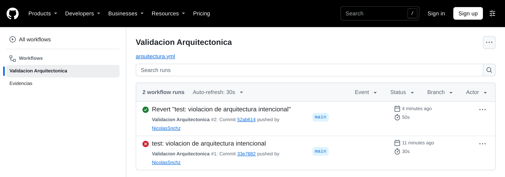

| Build fallido por la violación | Build en verde tras el revert |
|---|---|
| 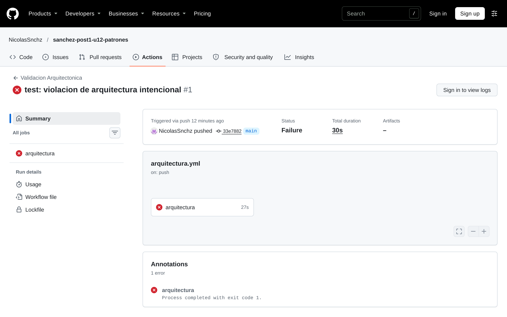 | 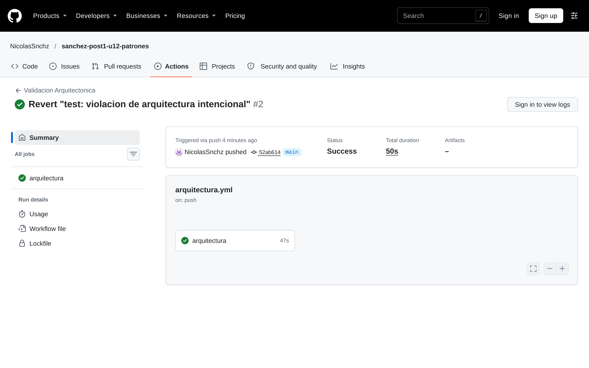 |

GitHub solo muestra el registro de un job a quien inicia sesión, así que el detalle del fallo lo saqué de la misma ejecución con el flujo temporal de medición. La Regla 1 encuentra el campo y la llamada al repositorio dentro de `ValidadorDuplicados`:

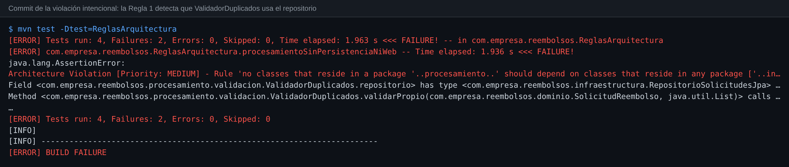

Ese build también marcó la Regla 2, que resultó venir rota desde la guía ([ver inconsistencias](#inconsistencias-del-enunciado-y-cómo-las-resolví)). La corregí en [`bfde56f`](https://github.com/NicolasSnchz/sanchez-post1-u12-patrones/commit/bfde56f2efd2de0466667d46e186487da8b92cca), antes del revert. Después del revert pasan las 4 reglas y la suite completa, con JDK 17 y con JDK 23:

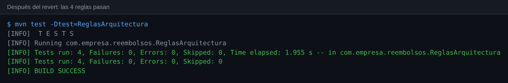

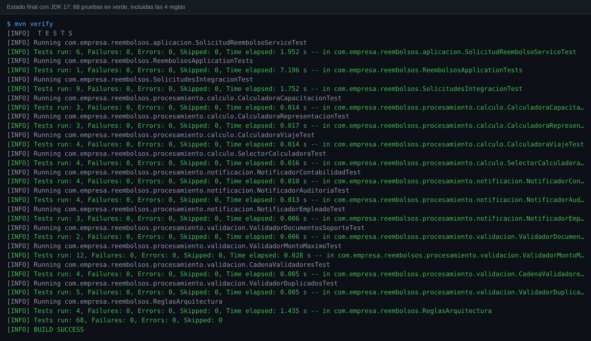

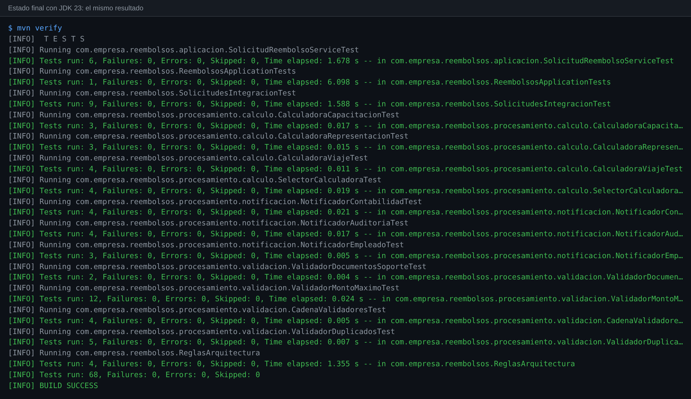

### El flujo completo por la API

Con la aplicación arrancada de verdad (`java -jar`), un script recorre la API con `curl` ([`api-flujo.txt`](docs/evidencias/logs/api-flujo.txt)). Las tres categorías calculan bien su monto aprobado: 400.000 de un viaje de 3 días, 1.200.000 de representación y 800.000, que es el 80 %, de una capacitación de 1.000.000. Cada etapa de la cadena rechaza con su propio motivo:

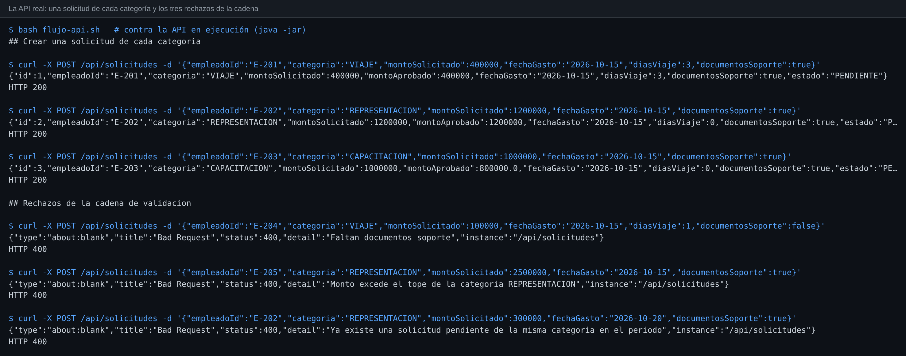

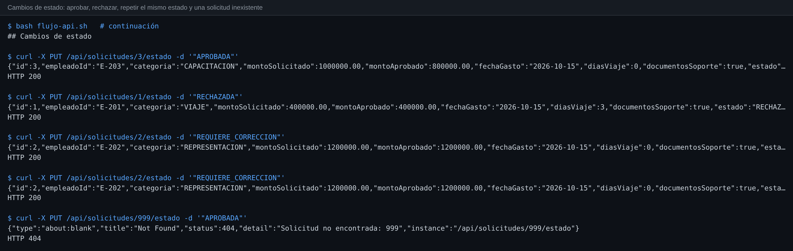

Y esto es lo que imprimen los observadores en esa misma ejecución:

- La aprobación avisa a los tres interesados.
- El rechazo y la corrección no llegan a Contabilidad.
- Repetir REQUIERE_CORRECCION no vuelve a notificar a nadie.

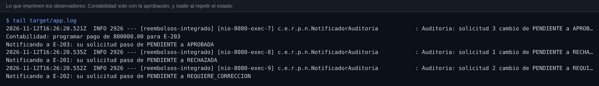

### Pruebas

**68 pruebas en verde.** JaCoCo mide 98,4 % de líneas (126 de 128) y 100 % de ramas (20 de 20) en el estado final ([`final.xml`](docs/evidencias/jacoco/final.xml)). Las dos líneas sin cubrir son el `main` de `ReembolsosApplication`.

| Clase de prueba | Pruebas | Qué comprueba | Doble de prueba |
|---|---|---|---|
| `ValidadorDocumentosSoporteTest`, `ValidadorMontoMaximoTest`, `ValidadorDuplicadosTest` | 2, 12, 5 | Cada eslabón por separado: los bordes exactos de cada tope, el tope de viaje por días, que toda categoría tenga tope, y que el mismo mes de otro año no cuente como duplicado | Ninguno |
| [`CadenaValidadoresTest`](https://github.com/NicolasSnchz/sanchez-post1-u12-patrones/blob/main/src/test/java/com/empresa/reembolsos/procesamiento/validacion/CadenaValidadoresTest.java) | 4 | El orden de la Decisión 1: con varias fallas, gana la del primer eslabón | Ninguno |
| `CalculadoraViajeTest`, `CalculadoraRepresentacionTest`, `CalculadoraCapacitacionTest` | 4, 3, 3 | Cada fórmula por debajo, justo en y por encima de su tope | Ninguno |
| [`SelectorCalculadoraTest`](https://github.com/NicolasSnchz/sanchez-post1-u12-patrones/blob/main/src/test/java/com/empresa/reembolsos/procesamiento/calculo/SelectorCalculadoraTest.java) | 4 | Que toda categoría del `enum` tenga su calculadora, y el error claro cuando falta | Ninguno |
| `NotificadorEmpleadoTest`, `NotificadorContabilidadTest`, `NotificadorAuditoriaTest` | 3, 4, 4 | Contabilidad solo con APROBADA, auditoría con todo estado y el empleado con cada resultado | Captura de consola y un `ListAppender` de Logback para el registro |
| [`SolicitudReembolsoServiceTest`](https://github.com/NicolasSnchz/sanchez-post1-u12-patrones/blob/main/src/test/java/com/empresa/reembolsos/aplicacion/SolicitudReembolsoServiceTest.java) | 6 | Que crea calculando y deja PENDIENTE, que una solicitud inválida no se guarda, que descarta el `id` del cliente, que avisa con el estado anterior y que repetir el estado no avisa | **Mock** del repositorio (`verify` solo para comprobar que no se guardó) y **spy** de observador con una lambda |
| [`SolicitudesIntegracionTest`](https://github.com/NicolasSnchz/sanchez-post1-u12-patrones/blob/main/src/test/java/com/empresa/reembolsos/SolicitudesIntegracionTest.java) | 9 | Todo el flujo por HTTP con H2: las 3 categorías, los rechazos 400 con su motivo, el 404, y los avisos de un cuarto observador registrado solo para la prueba | Ninguno: contexto real de Spring |
| `ReembolsosApplicationTests` | 1 | Que el contexto arranca | Ninguno |
| [`ReglasArquitectura`](https://github.com/NicolasSnchz/sanchez-post1-u12-patrones/blob/main/src/test/java/com/empresa/reembolsos/ReglasArquitectura.java) | 4 | Los límites entre paquetes | Ninguno |

Que el dominio no depende de Spring ni de JPA, y que `ValidadorDuplicados` no importa nada de infraestructura, se ve directo en los imports:

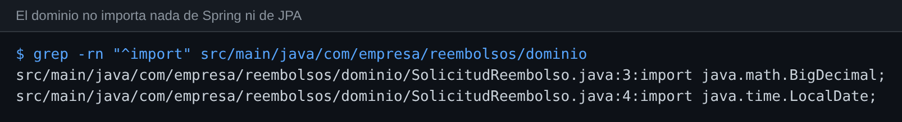

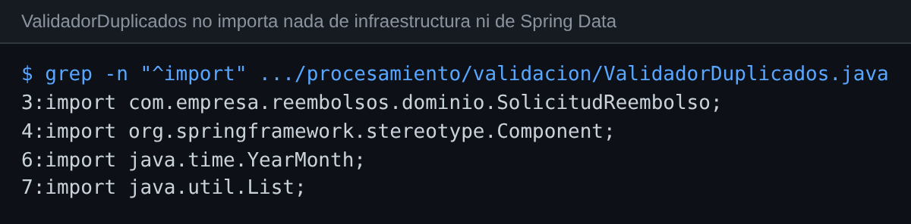

### Experimentos que respaldan las decisiones y las inconsistencias

Cada experimento corrió en GitHub Actions sobre el código final, cambiando una sola cosa:

| Experimento | Resultado | Registro |
|---|---|---|
| Las 4 reglas copiadas tal cual de la guía | Fallan las reglas 2, 3 y 4. La 3 y la 4 caen por `SelectorCalculadora` y por las clases de prueba | 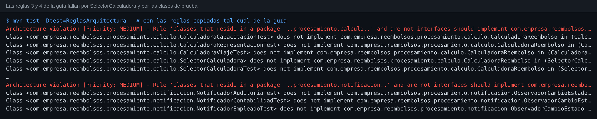 |
| La violación del Paso 5 tal como la describe la guía (solo el `import`) | La Regla 1 **pasa**: el `import` no deja rastro en el `.class` | [registro](docs/evidencias/logs/experimento-solo-import.log) |
| La Regla 1 prohibiendo todo `org.springframework` (Decisión 4) | Falla en las 11 clases de `procesamiento` y solo por `@Component` | 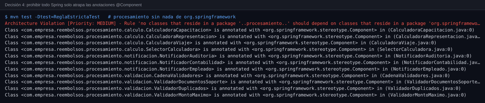 |
| Sin `orm.xml` | La aplicación no arranca: *Not a managed type* | 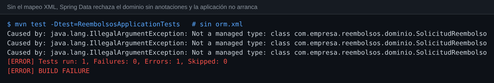 |
| ArchUnit 1.2.1, la versión del Paso 2, con JDK 17 y 23 | Se comporta igual que la 1.3.0 | [JDK 17](docs/evidencias/logs/experimento-archunit-1.2.1-jdk17.log), [JDK 23](docs/evidencias/logs/experimento-archunit-1.2.1-jdk23.log) |

### Cómo la medí

Maven no puede descargar dependencias desde mi entorno de trabajo. Por eso toda la medición corrió en GitHub Actions con un flujo temporal ([`medir.sh`](https://github.com/NicolasSnchz/sanchez-post1-u12-patrones/blob/f34a7882abb07471532bc3fe4767d7d0a0e2d20b/.github/evidencias/medir.sh)), que se retiró en [`744bbdf`](https://github.com/NicolasSnchz/sanchez-post1-u12-patrones/commit/744bbdf25299a3f3c22a13f8b97a05b328abf652). Ese flujo ejecutó cada commit relevante tal como está en el historial y los experimentos de arriba, y publicó los registros completos que guardé en [`docs/evidencias`](docs/evidencias) ([resumen](docs/evidencias/resumen.txt)).

### Historial

| Commit | Mensaje |
|---|---|
| [`28480cf`](https://github.com/NicolasSnchz/sanchez-post1-u12-patrones/commit/28480cff52411659d39e39fb74e9a8b103ca3988) | docs: analizar requisitos y proponer diseno de patrones antes de implementar |
| [`740df5f`](https://github.com/NicolasSnchz/sanchez-post1-u12-patrones/commit/740df5fd07c52c2f2756ad9b855742f5e6affdcb) | feat: implementar cadena de validadores para las solicitudes de reembolso |
| [`6e85dd4`](https://github.com/NicolasSnchz/sanchez-post1-u12-patrones/commit/6e85dd453066fb4480a4f8a21b3f50be37c98246) | feat: implementar estrategias de calculo por categoria de gasto |
| [`1b700af`](https://github.com/NicolasSnchz/sanchez-post1-u12-patrones/commit/1b700af04bdf7f75bb7df2032bad241e77e852be) | feat: implementar notificacion a interesados ante cambios de estado |
| [`95517bc`](https://github.com/NicolasSnchz/sanchez-post1-u12-patrones/commit/95517bce2918a16f3216e3d8a510646c65b25ce5) | feat: ensamblar SolicitudReembolsoService y el controlador REST |
| [`6f76cbf`](https://github.com/NicolasSnchz/sanchez-post1-u12-patrones/commit/6f76cbff5c111af2c9f14db3652aaa23b8699d7a) | docs: documentar la arquitectura y las decisiones de diseno 1 y 2 de la Parte 1 |
| [`57f2c9d`](https://github.com/NicolasSnchz/sanchez-post1-u12-patrones/commit/57f2c9d267fc0b7d078ba75d4dd4e3b3d9ed8c9f) | docs: agregar ADR-001 con la decision arquitectonica de persistencia y notificacion |
| [`cb24d30`](https://github.com/NicolasSnchz/sanchez-post1-u12-patrones/commit/cb24d30f4a6c66690cc9a6dac7cd32a2a01c20e2) | test: agregar dependencia ArchUnit y las 4 reglas de arquitectura en ReglasArquitectura |
| [`8bc987e`](https://github.com/NicolasSnchz/sanchez-post1-u12-patrones/commit/8bc987e02cce8a6bf4985d8f5783e02651132c35) | ci: agregar workflow de GitHub Actions para validacion arquitectonica |
| [`64ef5ba`](https://github.com/NicolasSnchz/sanchez-post1-u12-patrones/commit/64ef5ba13095fabde3c7502c1d8d0121eb1fe0a2) | docs: documentar analisis de impacto y patrones descartados por sobreingenieria |
| [`f34a788`](https://github.com/NicolasSnchz/sanchez-post1-u12-patrones/commit/f34a7882abb07471532bc3fe4767d7d0a0e2d20b) | ci: flujo temporal para medir la evidencia del proyecto |
| [`33e7882`](https://github.com/NicolasSnchz/sanchez-post1-u12-patrones/commit/33e78828b7a4b369be928285f68361a5213c07ab) | test: violacion de arquitectura intencional |
| [`bfde56f`](https://github.com/NicolasSnchz/sanchez-post1-u12-patrones/commit/bfde56f2efd2de0466667d46e186487da8b92cca) | test: permitir en la Regla 2 que el controlador use su propio paquete |
| [`5f9e92b`](https://github.com/NicolasSnchz/sanchez-post1-u12-patrones/commit/5f9e92b5ddd6223f6f12723553688aaa98fc25ec) | ci: medir el estado final del revert tambien con JDK 23 |
| [`52ab614`](https://github.com/NicolasSnchz/sanchez-post1-u12-patrones/commit/52ab6146759e2a0dab9a65a9fef84913d038aceb) | Revert "test: violacion de arquitectura intencional" |
| [`744bbdf`](https://github.com/NicolasSnchz/sanchez-post1-u12-patrones/commit/744bbdf25299a3f3c22a13f8b97a05b328abf652) | ci: retirar el flujo temporal de medicion, con la evidencia guardada en docs |
| (este commit) | docs: consolidar README con diseno propuesto, decisiones, ADR y analisis de impacto |

## Checkpoints de la guía y dónde se cumplen

| Checkpoint | Dónde se cumple |
|---|---|
| El README tiene el Diseño Propuesto antes de cualquier código de patrones | Primer commit ([`28480cf`](https://github.com/NicolasSnchz/sanchez-post1-u12-patrones/commit/28480cff52411659d39e39fb74e9a8b103ca3988)): el README y el dominio, sin ninguna clase de `procesamiento` |
| `mvn clean package` compila y el dominio no importa Spring ni JPA | [Captura](docs/capturas/p1-compila-dominio.png) y [imports](docs/capturas/p1-imports-dominio.png) |
| POST crea solicitudes de las 3 categorías, calcula bien y rechaza sin documentos con un mensaje claro | [Flujo de la API](docs/capturas/api-crear-y-rechazar.png) y `SolicitudesIntegracionTest` |
| PUT dispara a los tres observadores y Contabilidad solo actúa con APROBADA | [Notificaciones](docs/capturas/api-notificaciones.png) |
| `ValidadorDuplicados` no importa infraestructura ni Spring Data | [Imports](docs/capturas/p1-imports-validador-duplicados.png) |
| Mínimo 6 unitarias (una por validador y por calculadora) y 1 de integración `@SpringBootTest` | 54 unitarias, 9 de integración por HTTP con `@SpringBootTest`, `contextLoads` y las 4 reglas ([tabla](#pruebas)) |
| Decisiones de diseño 1 y 2 documentadas | [Decisiones](#decisiones-de-diseño) |
| `mvn test -Dtest=ReglasArquitectura` ejecuta 4 pruebas y todas pasan | [Captura](docs/capturas/p2-reglas-verde.png) |
| ADR-001 con consecuencias positivas y negativas | [`docs/adr/ADR-001.md`](docs/adr/ADR-001.md) |
| "Qué se descartó y por qué" con al menos un elemento propio y su señal | Tres propios, además de los dos de referencia ([tabla](#qué-se-descartó-y-por-qué)) |
| Un commit del historial muestra el pipeline fallando por la violación de la Regla 1 | [`33e7882`](https://github.com/NicolasSnchz/sanchez-post1-u12-patrones/commit/33e78828b7a4b369be928285f68361a5213c07ab) ([historial](#el-pipeline-detecta-la-violación)) |
| `mvn verify` pasa tras revertir la violación | [`52ab614`](https://github.com/NicolasSnchz/sanchez-post1-u12-patrones/commit/52ab6146759e2a0dab9a65a9fef84913d038aceb), 68 pruebas con JDK 17 y 23 |
| Mínimo 3 commits por parte | 6 en la Parte 1 y 11 en la Parte 2 (8 sin contar los 3 del flujo temporal de medición) |

## Inconsistencias del enunciado y cómo las resolví

| Qué dice el enunciado | El problema | Cómo lo resolví |
|---|---|---|
| El dominio "no importa ninguna clase de Spring ni de JPA", y `RepositorioSolicitudesJpa` extiende `JpaRepository<SolicitudReembolso, Long>` | Spring Data JPA solo acepta entidades JPA: sin `@Entity` la aplicación no arranca (*Not a managed type*). Las dos frases no se pueden cumplir a la vez con anotaciones | Mapeo `SolicitudReembolso` en [`orm.xml`](https://github.com/NicolasSnchz/sanchez-post1-u12-patrones/blob/main/src/main/resources/META-INF/orm.xml), el archivo de mapeo XML del estándar JPA, y lo registro con `spring.jpa.mapping-resources`. La clase del dominio queda sin una sola anotación y el repositorio funciona |
| `ValidadorMontoMaximo` usa un tope de 150.000 para VIAJE | El RF2 dice que en viajes el tope es **diario** y se multiplica por los días. Con el código de la guía, un viaje de 3 días por 400.000 se rechaza aunque la calculadora aprobaría hasta 450.000 | El tope de viaje en el validador también es diario por días ([línea](https://github.com/NicolasSnchz/sanchez-post1-u12-patrones/blob/main/src/main/java/com/empresa/reembolsos/procesamiento/validacion/ValidadorMontoMaximo.java#L18)). Lo fijan las pruebas de [`ValidadorMontoMaximoTest`](https://github.com/NicolasSnchz/sanchez-post1-u12-patrones/blob/main/src/test/java/com/empresa/reembolsos/procesamiento/validacion/ValidadorMontoMaximoTest.java#L37) |
| `ValidadorDuplicados` compara `getMonth()` | Compara solo el mes y no el año: octubre de 2025 y octubre de 2026 cuentan como el "mismo período" | Comparo con `YearMonth` ([línea](https://github.com/NicolasSnchz/sanchez-post1-u12-patrones/blob/main/src/main/java/com/empresa/reembolsos/procesamiento/validacion/ValidadorDuplicados.java#L16)), y [una prueba](https://github.com/NicolasSnchz/sanchez-post1-u12-patrones/blob/main/src/test/java/com/empresa/reembolsos/procesamiento/validacion/ValidadorDuplicadosTest.java#L40) lo fija |
| El servicio lanza `SolicitudInvalidaException` | La guía no la define y el controlador no la traduce, así que el checkpoint de "rechaza con un mensaje claro" respondería un error 500 | La creé en `aplicacion`, junto con `SolicitudNoEncontradaException`, y [`ManejadorErrores`](https://github.com/NicolasSnchz/sanchez-post1-u12-patrones/blob/main/src/main/java/com/empresa/reembolsos/adaptadores/rest/ManejadorErrores.java) las traduce a 400 y 404 con el motivo en el campo `detail` |
| `cambiarEstado` guarda y notifica siempre | Si se envía dos veces APROBADA, Contabilidad programa dos pagos. El RF3 habla de cuando el estado *cambia* | Si el estado no cambia, no se guarda ni se notifica |
| `crear` guarda la solicitud tal como llega por JSON | Si el cliente envía un `id`, `save` sobrescribe otra solicitud existente | `crear` descarta el `id` recibido |
| La Regla 3 exige que toda clase de `procesamiento.calculo` que no sea interfaz implemente `CalculadoraReembolso` | `SelectorCalculadora`, de la propia guía, vive en ese paquete y no la implementa, así que la regla falla con el código del enunciado | La regla aplica a las clases que se llaman `Calculadora*`, que son las estrategias ([regla](https://github.com/NicolasSnchz/sanchez-post1-u12-patrones/blob/main/src/test/java/com/empresa/reembolsos/ReglasArquitectura.java#L39)) |
| `@AnalyzeClasses(packages = "com.empresa.reembolsos")` | Importa también las clases de prueba. `CalculadoraViajeTest`, que vive en `procesamiento.calculo`, no implementa `CalculadoraReembolso` y rompe la Regla 3 (lo mismo pasa con la 4) | `importOptions = ImportOption.DoNotIncludeTests.class`: las reglas miran el código de producción |
| `mvn test -Dtest=ReglasArquitectura` y luego `mvn verify` | El nombre `ReglasArquitectura` no coincide con los patrones que Surefire ejecuta por defecto (`*Test`, `*Tests`, `Test*`, `*TestCase`), así que `mvn verify` nunca corría las 4 reglas | Agregué `ReglasArquitectura` a los `includes` de Surefire en el [`pom.xml`](https://github.com/NicolasSnchz/sanchez-post1-u12-patrones/blob/main/pom.xml#L67): las reglas corren solas con `-Dtest` y también dentro de la suite completa |
| ArchUnit 1.2.1 | Los prerrequisitos piden "ArchUnit 1.x" y el Paso 2 fija la 1.2.1 | Uso la 1.3.0, que ya había probado con JDK 17 y 23 en la unidad 11. La 1.2.1 también la probé y funciona igual con JDK 17 y 23 ([registro](docs/evidencias/logs/experimento-archunit-1.2.1-jdk23.log)); elegí la 1.3.0 por ser la que ya tenía probada con JUnit en las dos versiones. |
| El workflow usa `actions/checkout@v4`, `actions/setup-java@v4`, `actions/cache@v3` y `ubuntu-latest` | Son versiones que GitHub ya marca con advertencias de obsolescencia | `checkout@v5`, `setup-java@v5` con `cache: maven` (reemplaza a `actions/cache`) y `ubuntu-24.04` |
| La Regla 2 permite que el controlador acceda solo a `aplicacion`, `dominio`, `org.springframework.web..`, `org.springframework.http..` y `java..` | ArchUnit cuenta como acceso que el controlador lea su propio campo `servicio`, y `SolicitudReembolsoController` vive en `adaptadores.rest`, que no está en la lista. La regla falla con el controlador de la propia guía, sin ninguna violación ([captura](docs/capturas/p2-regla2-guia-falla.png)). No lo vi hasta que las reglas corrieron en GitHub, y por eso el build de la violación falló por la Regla 1 *y también* por la 2 | En el commit [`bfde56f`](https://github.com/NicolasSnchz/sanchez-post1-u12-patrones/commit/bfde56f2efd2de0466667d46e186487da8b92cca) agregué `..adaptadores.rest..` a la lista ([regla](https://github.com/NicolasSnchz/sanchez-post1-u12-patrones/blob/main/src/test/java/com/empresa/reembolsos/ReglasArquitectura.java#L33)), antes del revert. Las 4 reglas pasan desde ahí |
| El Paso 5 introduce la violación "importando `RepositorioSolicitudesJpa` dentro de `ValidadorDuplicados`" | Un `import` sin usar no queda en el `.class`, y ArchUnit analiza el compilado. Con solo el import, la Regla 1 pasa y el pipeline sigue en verde. Lo comprobé en GitHub Actions ([registro](docs/evidencias/logs/experimento-solo-import.log)) | La violación del commit [`33e7882`](https://github.com/NicolasSnchz/sanchez-post1-u12-patrones/commit/33e78828b7a4b369be928285f68361a5213c07ab) *usa* el repositorio: `ValidadorDuplicados` lo recibe por constructor y consulta los pendientes él mismo, como haría alguien que quiere "optimizar" |
| El primer commit hace `git add pom.xml src/main/java/.../dominio/ README.md` | Deja fuera `ReembolsosApplication`, `application.properties`, el `.gitignore` y la prueba que genera Spring Initializr, que el checkpoint necesita para `mvn clean package` | Los incluí en el primer commit |
| "No marcar Add a README ni agregar .gitignore (el proyecto de Spring Initializr ya incluye ambos)" | Spring Initializr genera el `.gitignore` y un `HELP.md`, pero no un README | Escribí este README desde el primer commit, que es donde la guía pide el Diseño Propuesto |
| El repositorio se llama `apellido-post1-u12` | | Lo llamé `sanchez-post1-u12-patrones`, como mis entregas anteriores |

## Estructura, ejecución y herramientas

```text
src/main/java/com/empresa/reembolsos/
├── dominio/            SolicitudReembolso, CategoriaGasto, EstadoSolicitud (sin Spring ni JPA)
├── procesamiento/
│   ├── validacion/     ValidadorSolicitud y sus 3 eslabones, CadenaValidadores, ResultadoValidacion
│   ├── calculo/        CalculadoraReembolso, 3 calculadoras, SelectorCalculadora
│   └── notificacion/   ObservadorCambioEstado y 3 notificadores
├── aplicacion/         SolicitudReembolsoService y sus dos excepciones
├── infraestructura/    RepositorioSolicitudesJpa
└── adaptadores/rest/   SolicitudReembolsoController, ManejadorErrores
src/main/resources/META-INF/orm.xml      mapeo JPA del dominio
src/test/java/com/empresa/reembolsos/ReglasArquitectura.java
docs/adr/ADR-001.md
.github/workflows/arquitectura.yml
```

```bash
mvn clean package                         # compila y corre toda la suite
mvn test -Dtest=ReglasArquitectura        # solo las 4 reglas de arquitectura
mvn spring-boot:run                       # API en http://localhost:8080
```

```bash
curl -X POST localhost:8080/api/solicitudes -H "Content-Type: application/json" \
  -d '{"empleadoId":"E-1","categoria":"CAPACITACION","montoSolicitado":1000000,"fechaGasto":"2026-10-15","documentosSoporte":true}'
curl -X PUT localhost:8080/api/solicitudes/1/estado -H "Content-Type: application/json" -d '"APROBADA"'
```

**Herramientas:** Java 17 (probado también con JDK 23), Spring Boot 3.5.15 (Spring Web, Spring Data JPA y H2), JUnit 5, Mockito, ArchUnit 1.3.0, JaCoCo, GitHub Actions, Git y GitHub.

## Conclusiones

Lo más valioso fue escribir el diseño antes del código: identificar qué variaba en cada requisito hizo que los tres patrones se eligieran solos, y que cada uno se pudiera probar sin los otros dos. Medir todo en GitHub cambió varias conclusiones que en el papel parecían obvias: la violación sugerida por la guía no se habría detectado, dos de sus cuatro reglas fallaban con su propio código y el dominio sin JPA no arrancaba con su repositorio. El ADR me obligó a responder el criterio de la Hexagonal con datos del proyecto, y la respuesta resultó distinta para la persistencia y para la notificación, que ya tenía su puerto sin haberlo llamado así. Por último, la sección de descartes me enseñó que decir no a un patrón también hay que justificarlo, y que la justificación vale más si dice qué la haría cambiar.
