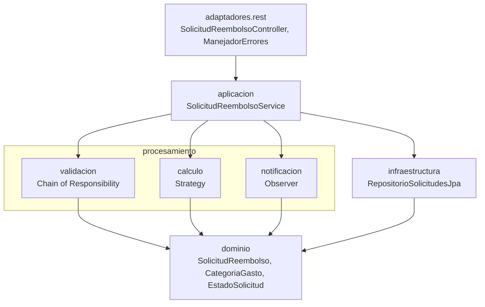

# Reembolsos Integrado: solicitudes de reembolso de gastos corporativos

Post-contenido de la unidad 12 de Patrones de Diseño de Software (UDES). Nicolás Andrés Sánchez Villamizar.

Sistema para que el área de Finanzas reemplace su hoja de cálculo de reembolsos. Los empleados registran una solicitud con la categoría del gasto, el monto, la fecha y sus documentos soporte, y el sistema la valida, calcula el monto aprobado y avisa a los interesados cada vez que cambia de estado. 

## Contenido

1. [Diseño Propuesto](#diseño-propuesto)
2. [Arquitectura resultante](#arquitectura-resultante)
3. [Decisiones de diseño](#decisiones-de-diseño)
8. [Inconsistencias del enunciado y cómo las resolví](#inconsistencias-del-enunciado-y-cómo-las-resolví)
9. [Estructura, ejecución y herramientas](#estructura-ejecución-y-herramientas)

## Diseño Propuesto

Esta sección la escribí antes de implementar cualquier patrón: está en el primer commit del repositorio, junto con el modelo de dominio y sin una sola clase de `procesamiento`. Para cada requisito busqué primero qué es lo que cambia y después qué patrón aísla justo eso.

| Requisito | Punto de variabilidad concreto | Patrón | Por qué ese patrón y no otro |
|---|---|---|---|
| **RF1.** Validación en varias etapas | El conjunto de verificaciones: hoy son tres (documentos, tope de la categoría y duplicados), y Finanzas ya anunció una cuarta (límite anual acumulado). La primera que falla decide el motivo del rechazo. | **Chain of Responsibility** | Cada verificación decide sola si rechaza o deja pasar la solicitud al siguiente eslabón, así que la verificación nueva se agrega como un eslabón más sin abrir las que ya existen. |
| **RF2.** Cálculo distinto por categoría | La fórmula del monto aprobado: tope diario por días de viaje, monto completo hasta un tope mensual, o 80 % hasta un tope anual. Se elige una sola vez, por la categoría. | **Strategy** | Son algoritmos intercambiables que responden la misma pregunta (cuánto se aprueba) y se eligen por un dato de entrada, así que cada categoría nueva es una clase nueva y las fórmulas existentes no se tocan. |
| **RF3.** Notificación simultánea | Quiénes reaccionan a un cambio de estado y cómo: el empleado siempre, Contabilidad solo con aprobaciones y auditoría siempre, para su registro. Y el número de interesados crece (ya viene el panel de métricas). | **Observer** | El servicio solo anuncia que el estado cambió y cada interesado decide qué hacer, así que el panel de métricas entra como un observador más sin tocar el servicio ni los otros tres. |

**Alternativas que consideré para cada requisito**

- **RF1.** Una `List<Validador>` recorrida con un `for` también funcionaría, y lo reconozco: la diferencia con la cadena es pequeña. Elijo la cadena porque el requisito describe *etapas* en orden, donde la primera que falla detiene el proceso, y porque así cada eslabón es una clase con una sola razón para cambiar. Descarto Decorator: ninguna verificación envuelve ni modifica el resultado de otra.
- **RF2.** Descarto Template Method, porque las tres fórmulas no comparten un esqueleto: lo único común es aplicar un tope al final. También descarto un `enum` con un método por constante, que fue lo que elegí en la unidad 11 para un conjunto de tipos *cerrado y estable*. Aquí el requisito dice lo contrario: vienen categorías nuevas cada semestre, y cada calculadora como bean propio se puede probar y agregar sola.
- **RF3.** Llamar a los tres notificadores directamente desde el servicio obligaría a editar el servicio con cada interesado nuevo, que es justo lo que el requisito quiere evitar.

**Cómo se componen.** Los tres patrones son independientes entre sí: viven en `procesamiento/validacion`, `procesamiento/calculo` y `procesamiento/notificacion`, y solo `SolicitudReembolsoService` los coordina. Ninguno conoce a los otros dos ni a la base de datos. El servicio carga los datos y se los entrega ya listos.

## Arquitectura resultante



Las flechas son dependencias de código y todas bajan:

- **El controlador** solo conoce el servicio.
- **El servicio** es el único punto que coordina los tres patrones y el único que conoce el repositorio ([`crear`](https://github.com/NicolasSnchz/sanchez-post1-u12-patrones/blob/main/src/main/java/com/empresa/reembolsos/aplicacion/SolicitudReembolsoService.java#L28) y [`cambiarEstado`](https://github.com/NicolasSnchz/sanchez-post1-u12-patrones/blob/main/src/main/java/com/empresa/reembolsos/aplicacion/SolicitudReembolsoService.java#L40)).
- **`procesamiento`** no sabe que existe una base de datos ni una API REST. Recibe la solicitud y la lista de pendientes ya cargadas.
- **`dominio`** no importa nada de Spring ni de JPA. La tabla se mapea en [`orm.xml`](https://github.com/NicolasSnchz/sanchez-post1-u12-patrones/blob/main/src/main/resources/META-INF/orm.xml), y la razón está en las [inconsistencias](#inconsistencias-del-enunciado-y-cómo-las-resolví).

| Patrón | Dónde está | Qué resuelve |
|---|---|---|
| Chain of Responsibility | [`ValidadorSolicitud`](https://github.com/NicolasSnchz/sanchez-post1-u12-patrones/blob/main/src/main/java/com/empresa/reembolsos/procesamiento/validacion/ValidadorSolicitud.java) y sus tres eslabones, armados en [`CadenaValidadores`](https://github.com/NicolasSnchz/sanchez-post1-u12-patrones/blob/main/src/main/java/com/empresa/reembolsos/procesamiento/validacion/CadenaValidadores.java) | RF1: una verificación nueva (el límite anual) es un eslabón más |
| Strategy | [`CalculadoraReembolso`](https://github.com/NicolasSnchz/sanchez-post1-u12-patrones/blob/main/src/main/java/com/empresa/reembolsos/procesamiento/calculo/CalculadoraReembolso.java), tres calculadoras y [`SelectorCalculadora`](https://github.com/NicolasSnchz/sanchez-post1-u12-patrones/blob/main/src/main/java/com/empresa/reembolsos/procesamiento/calculo/SelectorCalculadora.java) | RF2: una categoría nueva (bienestar) es una calculadora más |
| Observer | [`ObservadorCambioEstado`](https://github.com/NicolasSnchz/sanchez-post1-u12-patrones/blob/main/src/main/java/com/empresa/reembolsos/procesamiento/notificacion/ObservadorCambioEstado.java) y tres notificadores | RF3: un interesado nuevo (el panel de métricas) es un observador más |

## Decisiones de diseño

### Decisión de diseño 1: el orden de la cadena

**Orden elegido: documentos, luego monto y por último duplicados**, de la verificación más barata a la más cara ([`CadenaValidadores`](https://github.com/NicolasSnchz/sanchez-post1-u12-patrones/blob/main/src/main/java/com/empresa/reembolsos/procesamiento/validacion/CadenaValidadores.java#L16)).

| Eslabón | Qué revisa | Costo |
|---|---|---|
| `ValidadorDocumentosSoporte` | Un `boolean` de la solicitud | Constante |
| `ValidadorMontoMaximo` | Busca el tope de la categoría en un mapa y compara | Constante |
| `ValidadorDuplicados` | Recorre la lista de pendientes del empleado comparando categoría y período | Crece con el número de pendientes |

**Qué se gana poniendo el más caro al final:** una solicitud sin documentos o con un monto excesivo se rechaza sin recorrer la lista de pendientes. Esos son además los errores más probables de quien llena el formulario.

**Qué se pierde:**

- **El empleado solo ve el primer motivo.** Si le faltan los documentos *y* además ya tiene una solicitud pendiente del mismo período, primero corrige los documentos, vuelve a enviar y solo entonces se entera del duplicado. Con duplicados de primero, sabría de entrada que reenviar no sirve de nada mientras siga la pendiente.
- **El ahorro es menor de lo que parece.** La operación realmente cara es la consulta a la base de datos que trae los pendientes, y esa la hace el servicio [antes de llamar a la cadena](https://github.com/NicolasSnchz/sanchez-post1-u12-patrones/blob/main/src/main/java/com/empresa/reembolsos/aplicacion/SolicitudReembolsoService.java#L29), sea cual sea el orden. El orden solo ahorra el recorrido en memoria.

El orden queda fijado por las pruebas de [`CadenaValidadoresTest`](https://github.com/NicolasSnchz/sanchez-post1-u12-patrones/blob/main/src/test/java/com/empresa/reembolsos/procesamiento/validacion/CadenaValidadoresTest.java): con una solicitud que falla en las tres etapas, el motivo debe ser el de documentos.

### Decisión de diseño 2: un mapa de estrategias inyectado por Spring, no un switch

[`SelectorCalculadora`](https://github.com/NicolasSnchz/sanchez-post1-u12-patrones/blob/main/src/main/java/com/empresa/reembolsos/procesamiento/calculo/SelectorCalculadora.java) recibe la `List<CalculadoraReembolso>` con todas las calculadoras que Spring encuentra y la convierte en un mapa por categoría. El RF2 es explícito: Finanzas va a agregar categorías nuevas *sin modificar el cálculo de las existentes*. Esto es lo que cuesta agregar "bienestar" con cada opción:

| Cambio para agregar BIENESTAR | Con el mapa inyectado | Con un switch |
|---|---|---|
| Escribir la fórmula | Clase nueva `CalculadoraBienestar` con `@Component` | Un `case` nuevo |
| Archivo que hay que editar para la fórmula | Ninguno: el selector la recibe solo | El método que contiene las fórmulas de las otras tres categorías |
| Valor nuevo en `CategoriaGasto` | Sí (es la lista de categorías del dominio) | Sí |
| Tope nuevo en `ValidadorMontoMaximo` | Sí, una línea (el RF1 pide un tope por categoría) | Sí |

Solo el mapa cumple el RF2 tal como está escrito: ninguna línea de las calculadoras existentes ni del selector se toca. Siendo honesto, "sin tocar una sola línea ya escrita" no es literal en ninguna de las dos opciones: la categoría nueva tiene que existir en el `enum` y tener su tope. Esos dos olvidos no pasan en silencio. [`obtener_todaCategoriaTieneSuCalculadora`](https://github.com/NicolasSnchz/sanchez-post1-u12-patrones/blob/main/src/test/java/com/empresa/reembolsos/procesamiento/calculo/SelectorCalculadoraTest.java#L19) y [`validar_todaCategoriaTieneUnTopeConfigurado`](https://github.com/NicolasSnchz/sanchez-post1-u12-patrones/blob/main/src/test/java/com/empresa/reembolsos/procesamiento/validacion/ValidadorMontoMaximoTest.java#L51) recorren todos los valores del `enum` y fallan si a alguno le falta su calculadora o su tope. Y si dos calculadoras dijeran atender la misma categoría, `Collectors.toMap` lanzaría una excepción al arrancar, en vez de elegir una al azar.

## Inconsistencias del enunciado y cómo las resolví

| Qué dice el enunciado | El problema | Cómo lo resolví |
|---|---|---|
| El dominio "no importa ninguna clase de Spring ni de JPA", y `RepositorioSolicitudesJpa` extiende `JpaRepository<SolicitudReembolso, Long>` | Spring Data JPA solo acepta entidades JPA: sin `@Entity` la aplicación no arranca (*Not a managed type*). Las dos frases no se pueden cumplir a la vez con anotaciones | Mapeo `SolicitudReembolso` en [`orm.xml`](https://github.com/NicolasSnchz/sanchez-post1-u12-patrones/blob/main/src/main/resources/META-INF/orm.xml), el archivo de mapeo XML del estándar JPA, y lo registro con `spring.jpa.mapping-resources`. La clase del dominio queda sin una sola anotación y el repositorio funciona |
| `ValidadorMontoMaximo` usa un tope de 150.000 para VIAJE | El RF2 dice que en viajes el tope es **diario** y se multiplica por los días. Con el código de la guía, un viaje de 3 días por 400.000 se rechaza aunque la calculadora aprobaría hasta 450.000 | El tope de viaje en el validador también es diario por días ([línea](https://github.com/NicolasSnchz/sanchez-post1-u12-patrones/blob/main/src/main/java/com/empresa/reembolsos/procesamiento/validacion/ValidadorMontoMaximo.java#L18)). Lo fijan las pruebas de [`ValidadorMontoMaximoTest`](https://github.com/NicolasSnchz/sanchez-post1-u12-patrones/blob/main/src/test/java/com/empresa/reembolsos/procesamiento/validacion/ValidadorMontoMaximoTest.java#L37) |
| `ValidadorDuplicados` compara `getMonth()` | Compara solo el mes y no el año: octubre de 2025 y octubre de 2026 cuentan como el "mismo período" | Comparo con `YearMonth` ([línea](https://github.com/NicolasSnchz/sanchez-post1-u12-patrones/blob/main/src/main/java/com/empresa/reembolsos/procesamiento/validacion/ValidadorDuplicados.java#L16)), y [una prueba](https://github.com/NicolasSnchz/sanchez-post1-u12-patrones/blob/main/src/test/java/com/empresa/reembolsos/procesamiento/validacion/ValidadorDuplicadosTest.java#L40) lo fija |
| El servicio lanza `SolicitudInvalidaException` | La guía no la define y el controlador no la traduce, así que el checkpoint de "rechaza con un mensaje claro" respondería un error 500 | La creé en `aplicacion`, junto con `SolicitudNoEncontradaException`, y [`ManejadorErrores`](https://github.com/NicolasSnchz/sanchez-post1-u12-patrones/blob/main/src/main/java/com/empresa/reembolsos/adaptadores/rest/ManejadorErrores.java) las traduce a 400 y 404 con el motivo en el campo `detail` |
| `cambiarEstado` guarda y notifica siempre | Si se envía dos veces APROBADA, Contabilidad programa dos pagos. El RF3 habla de cuando el estado *cambia* | Si el estado no cambia, no se guarda ni se notifica |
| `crear` guarda la solicitud tal como llega por JSON | Si el cliente envía un `id`, `save` sobrescribe otra solicitud existente | `crear` descarta el `id` recibido |
| El primer commit hace `git add pom.xml src/main/java/.../dominio/ README.md` | Deja fuera `ReembolsosApplication`, `application.properties`, el `.gitignore` y la prueba que genera Spring Initializr, que el checkpoint necesita para `mvn clean package` | Los incluí en el primer commit |
| "No marcar Add a README ni agregar .gitignore (el proyecto de Spring Initializr ya incluye ambos)" | Spring Initializr genera el `.gitignore` y un `HELP.md`, pero no un README | Escribí este README desde el primer commit, que es donde la guía pide el Diseño Propuesto |
| El repositorio se llama `apellido-post1-u12` | | Lo llamé `sanchez-post1-u12-patrones`, como mis entregas anteriores |

## Estructura, ejecución y herramientas

```text
src/main/java/com/empresa/reembolsos/
├── dominio/            SolicitudReembolso, CategoriaGasto, EstadoSolicitud (sin Spring ni JPA)
├── procesamiento/
│   ├── validacion/     ValidadorSolicitud y sus 3 eslabones, CadenaValidadores, ResultadoValidacion
│   ├── calculo/        CalculadoraReembolso, 3 calculadoras, SelectorCalculadora
│   └── notificacion/   ObservadorCambioEstado y 3 notificadores
├── aplicacion/         SolicitudReembolsoService y sus dos excepciones
├── infraestructura/    RepositorioSolicitudesJpa
└── adaptadores/rest/   SolicitudReembolsoController, ManejadorErrores
src/main/resources/META-INF/orm.xml      mapeo JPA del dominio
```

```bash
mvn clean package                         # compila y corre toda la suite
mvn spring-boot:run                       # API en http://localhost:8080
```

```bash
curl -X POST localhost:8080/api/solicitudes -H "Content-Type: application/json" \
  -d '{"empleadoId":"E-1","categoria":"CAPACITACION","montoSolicitado":1000000,"fechaGasto":"2026-10-15","documentosSoporte":true}'
curl -X PUT localhost:8080/api/solicitudes/1/estado -H "Content-Type: application/json" -d '"APROBADA"'
```

**Herramientas:** Java 17 (probado también con JDK 23), Spring Boot 3.5.15 (Spring Web, Spring Data JPA y H2), JUnit 5, Mockito, JaCoCo, Git y GitHub.

